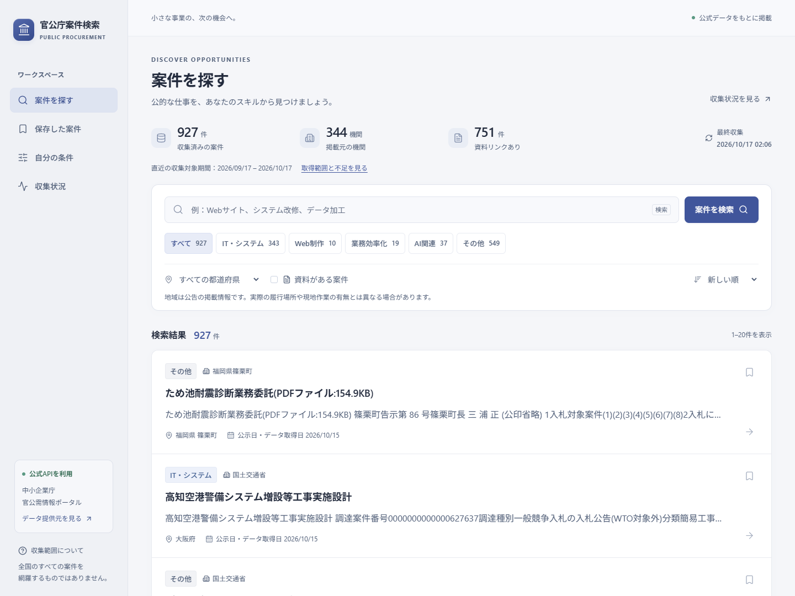
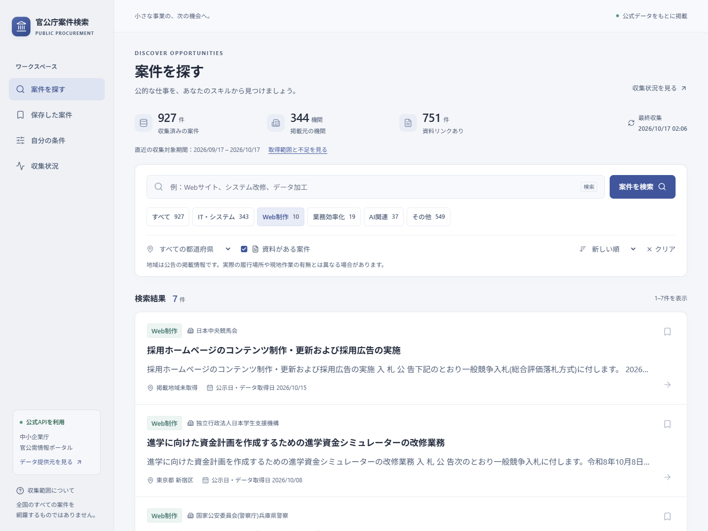
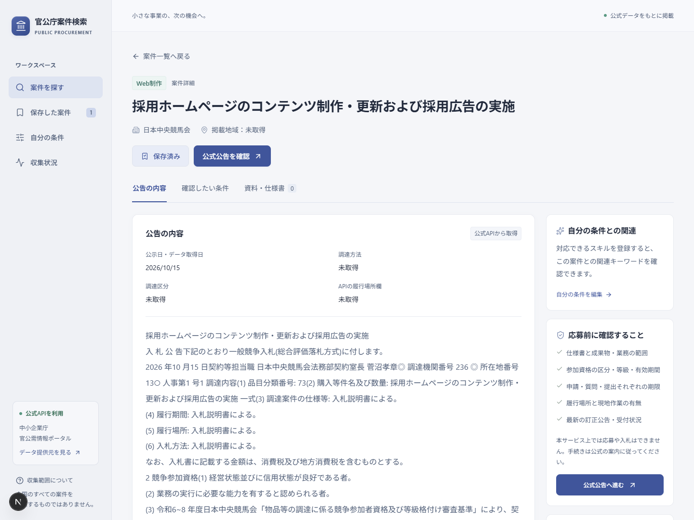
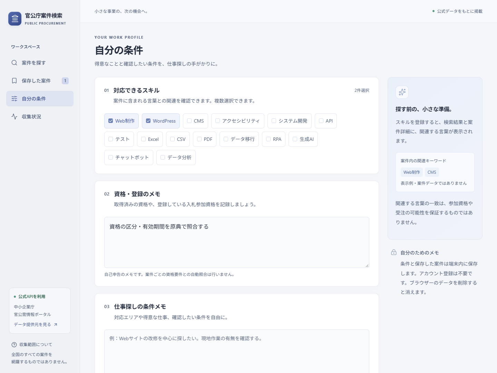
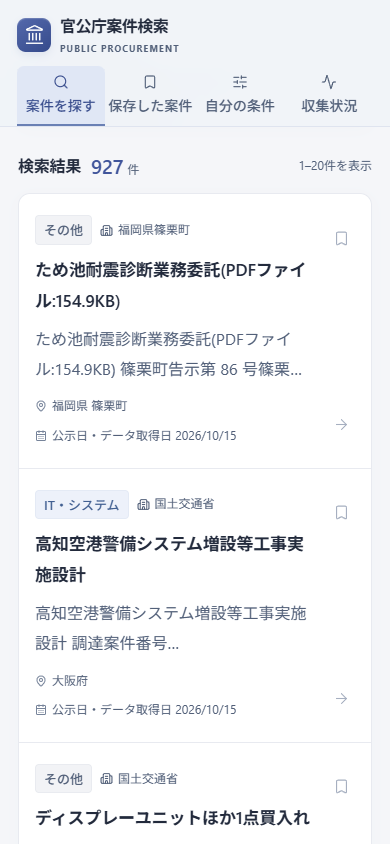

# 官公庁案件検索

個人事業主・小規模事業者が、公的な調達案件を探し、仕様書や参加条件を確認するためのWebアプリです。中小企業庁「官公需情報ポータルサイト検索API」から実在する公告を収集し、PostgreSQLへ蓄積します。検索・案件詳細は無料、アカウント登録なしで利用できます。

- **アプリ**：[官公庁案件検索](https://public-procurement-search.vercel.app)
- **公開リポジトリ**：[shunsoco-stack/public-procurement-search](https://github.com/shunsoco-stack/public-procurement-search)
- **データ提供元**：[官公需情報ポータルサイト](https://www.kkj.go.jp/s/)／[検索API仕様](https://www.kkj.go.jp/doc/ja/api_guide.pdf)／[利用規約](https://www.kkj.go.jp/s/?tc=1)

> 全国すべての調達案件を網羅していません。掲載されていても募集中とは限りません。参加条件・提出期限・変更や中止は、公式公告・仕様書で確認してください。自動応募・入札・契約の機能はありません。

## できること

- 件名・機関・本文のキーワード検索、業務分類、掲載情報の都道府県、資料リンクの有無、並べ替え、ページ送り
- IT・システム／Web制作／業務効率化／AI関連の分類と、その他の案件の保存・検索
- 案件詳細で公告本文、元公告、添付資料・仕様書へのリンク、収集日時を確認
- 参加条件・提出期限・金額・作業方法に関する**記載候補**を、元の文脈とともに表示
- 自己申告スキルとの関連キーワードを表示。参加可否や受注可能性のスコアは算出しません
- 案件のしおり保存（最大200件）、スキルと資格・希望条件のメモをブラウザー内へ保存
- 収集件数、対象期間、実際の検索条件、取りこぼしや障害、更新の遅れを公開

入力した資格・条件メモや保存した案件IDは、そのブラウザーのlocalStorageだけに保存します。他の端末との同期はなく、ブラウザーのデータを消すと失われます。

## 実画面

架空の案件カードや合成モックではなく、アプリが公式API由来の保存済み案件を表示している実画面です。撮影時点の件数・掲載内容は変わります。

### 1. PCで案件を検索



### 2. Web制作・資料リンクで絞り込み



### 3. 案件詳細と公式公告



### 4. 自分の条件を保存



### 5. スマートフォン



## データの範囲と正確性

APIに登録された国・省庁・独立行政法人・地方公共団体等の公告が対象です。APIに未掲載の機関・案件は取得できません。都道府県はAPIの掲載情報であり、実際の履行場所・対応可能地域とは限りません。

毎日6時台（日本時間）にVercel Cronで収集します。重点分野の5検索は直近30日、14都道府県のローテーション検索は直近14日が対象です。地域の検索対象は日ごとに変わり、4日間で47都道府県を検索対象に含めます。これは全国の案件の取得完了を意味しません。最新の検索条件・期間・取得件数はアプリの「収集状況」で確認できます。

1回の同期は6リクエスト、直列、リクエスト間隔1.1秒以上です。公式APIの上限は1,000件ですが、本アプリは負荷を抑えるため検索ごとに300件へ制限しています。ページング仕様がないため、総ヒット件数が返却件数を超えた場合は「一部取得」と記録・表示します。定期実行の遅延・失敗や無料枠の制約で更新が止まる可能性もあり、常時更新は保証しません。

| 項目 | 扱い |
| --- | --- |
| 公示日 | `CftIssueDate`。元データが不明ならポータル取得日が入るため「公示日・データ取得日」と表示 |
| ポータル取得日時 | `Date`。アプリの収集日時とは別に保存 |
| `TenderSubmissionDeadline` | 公式仕様上の**入札開始日**。応募締切には使いません |
| 資格・期限・金額・作業方法 | 欠損は不明。本文等の抜粋も未検証の候補であり、必須条件・募集状況へ自動変換しません |
| 分類・関連スキル | 決定論的なキーワード規則。誤分類・見落としがあり、応募適性を保証しません |
| 添付資料 | 原典へのリンク。リンク切れ、閲覧制限、差し替えの可能性があります。PDF等は再配布しません |

保存済みの公告は、今回の検索に出なかっただけでは削除・終了扱いにしません。API取得に失敗しても既存データは残し、架空案件への差し替えは行いません。

## 構成

```text
官公需情報ポータル検索API (XML)
  → 直列収集・XML検証・安全なURL・プレーンテキスト化
  → 分類・根拠候補の抽出
  → Neon PostgreSQL (公告 / 同期履歴 / 実行リース)
  → サーバー側データアクセス層・検索API
  → Next.jsの公開検索 / 詳細 / 原典への導線
```

Next.js 16.3／React 19／TypeScript／PostgreSQL（Neon）／pg + Vercel Fluid Compute／fast-xml-parser／Vitest／Playwright／axe-core／Vercel。Apple Designの考え方を取り入れ、システムフォント、即時の操作応答、落ち着いた階層、レスポンシブ表示、キーボード操作、ダークモード、Reduced Motionに対応します。

SQLはパラメーター化し、同期はDBリースで重複実行を抑止します。公開ユーザーは収集・DB書き込みを実行できません。Cronは長いランダムな`CRON_SECRET`と定時間比較で認証し、未設定なら拒否します。公告本文のHTMLは実行せず、リンクは資格情報を含まないHTTP(S)だけを許可します。XMLのDOCTYPE・ENTITYや過大な応答は拒否します。

## ローカル開発

Node.js 24、npm、PostgreSQL接続先が必要です。Next.jsのAPIは更新されるため、実装前に`node_modules/next/dist/docs/`も参照してください。

```sh
npm ci
```

`.env.example`を参考に、Git管理しない`.env.local`へ接続情報を設定します。Vercelに連携済みなら、対象プロジェクトを確認して`vercel env pull .env.local`でDevelopment用の値を取得できます。秘密値をGit、ログ、スクリーンショットへ含めないでください。

- `DATABASE_URL`：アプリ用のpooled接続
- `DATABASE_URL_UNPOOLED`：マイグレーション用のdirect接続
- `CRON_SECRET`：本番Cron用。16文字以上のランダム値を設定

```sh
npm run db:migrate
npm run data:sync
npm run dev
```

[http://localhost:3037](http://localhost:3037)を開きます。`data:sync`は**実APIを呼び、DBへ保存する管理用コマンド**です。テストのたびに実行しないでください。DB・公式APIが利用できない場合はエラーを表示します。架空データのデモモードはありません。

## 検証

```sh
npm run lint
npm run typecheck
npm test
npm run build
npm run test:e2e -- http://localhost:3037
npm run test:a11y -- http://localhost:3037
npm run screenshots -- https://public-procurement-search.vercel.app
```

単体テストでは欠損XML・添付・APIエラー、危険URL、入札開始日と締切の混同、資格の代替条件・否定文、検索のパラメーター化、同期障害・排他・件数上限を検証します。E2Eは実DBの検索→絞り込み→詳細→原典リンク、保存と再読込、プロフィールと関連表示、空検索、存在しない案件、未認証のCron拒否、別ブラウザーの保存分離、PC・スマートフォン・タブレット・ダーク表示を確認します。

Playwrightのローカル既定ブラウザーはMicrosoft Edgeです。他の環境ではChromiumをインストールし、`PLAYWRIGHT_CHANNEL=chromium`を指定してください。ブラウザーを自動操作するテストは、対象URLの実データが読み取れる状態で実行します。

### Secret Scan

[公式Gitleaks v8.30.1](https://github.com/gitleaks/gitleaks/releases/tag/v8.30.1)を導入して実行します。`GITLEAKS_PATH`でも実行ファイルを指定できます。CIは公式配布物のSHA-256を確認し、リポジトリ履歴をredact付きで検査します。

```sh
npm run scan:secrets -- --staged
npm run scan:secrets
```

CIはNode.js 24でlint・型検査・単体テスト・ビルド・Secret Scanを実施します。DB資格情報はCIへ渡さず、実データE2Eは対象の実行環境で別途確認します。

## Productionへの更新

現在はVercel CLIでProductionを更新しています。GitHubへのpushだけでは本番は更新されません。管理者は対象チーム・プロジェクトを確認してから実行してください。

```sh
vercel link --project public-procurement-search --scope shunsoco-stacks-projects
vercel --prod --scope shunsoco-stacks-projects
```

DBスキーマを変更する場合は、先に対象DBへのマイグレーションを確認してください。公開後は本番URLでE2Eとヘルスチェックを実行し、収集状況も確認します。`vercel.json`の日次CronはProductionに登録されます。

## 公開・掲載資料

- [ポートフォリオ掲載用プロンプト](docs/PORTFOLIO_INTEGRATION_PROMPT.md)
- [Tsukutta掲載用の原稿と画像順](docs/TSUKUTTA_SUBMISSION.md)
- [公開前後の検証記録](docs/VERIFICATION.md)

VercelのProductionへ公開済みです。GitHubの公開リポジトリに実画面5枚を保存し、README上での読み込みも確認しました。掲載資料には、全国網羅・資格審査・リアルタイム更新・自動応募を実装したかのような記載をしないでください。
